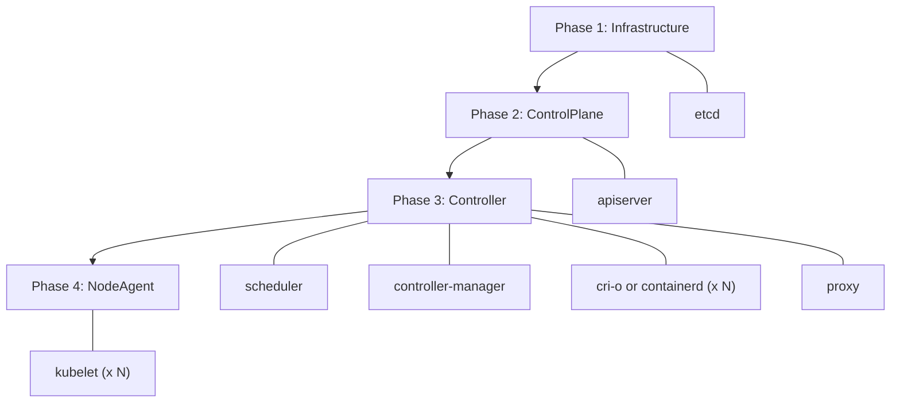

<picture>
  <source media="(prefers-color-scheme: dark)" srcset=".github/logo-dark.png">
  
</picture>

[](https://github.com/saschagrunert/kubernix/actions/workflows/ci.yml)
[](https://codecov.io/gh/saschagrunert/kubernix)
[](https://saschagrunert.github.io/kubernix/kubernix/index.html)
[](https://docs.rs/kubernix)
[](https://deps.rs/repo/github/saschagrunert/kubernix)
[](https://crates.io/crates/kubernix)
[](https://github.com/saschagrunert/kubernix/blob/main/LICENSE)

## Kubernetes development cluster bootstrapping with Nix packages

This project aims to provide **single dependency** [Kubernetes][1] clusters
for local testing, experimenting and development purposes.

[1]: https://kubernetes.io

Moving pictures are worth more than a thousand words, so here is a short demo:


### Nix?

Have you ever heard about [Nix][2], the functional package manager?

In case you haven’t, don’t worry, the important thing is that it provides all the third-party
dependencies needed for this project, pinned to a dedicated version. This guarantees stable,
reproducible installations.

[2]: https://nixos.org

KuberNix itself is a Rusty helper program, which takes care of bootstrapping
the Kubernetes cluster, passing the right configuration parameters around and
keeping track of the running processes.

### What is inside

The following technology stack is currently being used:

| Application     | Version  |
| --------------- | -------- |
| cni-plugins     | v1.9.1   |
| conmon-rs       | v1.1.1   |
| conntrack-tools | v1.4.9   |
| containerd      | v2.4.1   |
| cri-o-wrapper   | v1.37.2  |
| cri-tools       | v1.37.0  |
| crun            | v1.30.1  |
| etcd            | v3.7.2   |
| iproute2        | v7.2.0   |
| iptables        | v1.8.13  |
| kmod            | v31      |
| kubectl         | v1.37.1  |
| kubernetes      | v1.37.1  |
| nss-cacert      | v3.131.1 |
| podman          | v5.8.9   |
| rootlesskit     | v2.3.6   |
| runc            | v1.5.2   |
| slirp4netns     | v1.3.6   |
| socat           | v1.8.1.3 |
| util-linux      | v2.42.4  |

Some other tools are not explicitly mentioned here, because they are not
direct dependencies.

### Boot Phases

Components start in four sequential phases. Within each phase, components
start in parallel. If any component in a phase fails, subsequent phases
are skipped. Once all components are running, KuberNix deploys the cluster
addons (CoreDNS by default) in the background.



### Requirements

As already mentioned, there is only one real dependency needed to run this
project: **Nix**. To set up Nix, run:

```shell
$ curl -L https://nixos.org/nix/install | sh
```

Please make sure to follow the instructions output by the script. KuberNix
uses [flakes][3] and enables the `nix-command` and `flakes` experimental
features for its own Nix invocations, so they do not have to be enabled in
the Nix configuration, also not for root.

[3]: https://wiki.nixos.org/wiki/Flakes

Besides that, KuberNix expects a Linux host (`x86_64` or `aarch64`). All
cluster components and tools come from Nix.

KuberNix runs in **root mode** when started as root, for example via `sudo`:

- `nix` has to be in the `PATH` of root, so run it via
  `sudo env "PATH=$PATH" kubernix`.
- `sudo` drops the proxy variables (`http_proxy`, `https_proxy`, `no_proxy`
  and their upper case variants) by default. If Nix or the nodes need a proxy,
  keep them via `sudo -E env "PATH=$PATH" kubernix` or `Defaults env_keep`
  in the sudoers configuration.
- The kernel modules `overlay`, `br_netfilter` and `ip_conntrack` get loaded
  and the required sysctls get set automatically, and restored when the
  cluster stops (see [Networking](#networking)). Inside a container or a
  user namespace this step is skipped, so run
  [`contrib/prepare-system`](contrib/prepare-system) on the host instead.
- Root in a user namespace, like in a rootless `podman run --privileged`
  container, an unprivileged LXC container or with Docker `userns-remap`,
  runs in root mode as well, except in the shell of a rootless cluster.
- The run directory and all its parent directories have to belong to root or
  to the user running KuberNix via `sudo` (`SUDO_UID`). None of them may be
  writable by others, or by their group, unless the group is the private
  group of the owner (the primary group of the owner with the same name and
  no other members, like with the user private groups of Fedora or RHEL; no
  other user in `/etc/passwd` may have it as primary group, users of other
  NSS sources like LDAP are not checked). Parent directories with the sticky
  bit (like `/tmp`) may be writable by group and others. Otherwise another
  user could plant files or symbolic links in the run directory or replace
  it, which root would write to or execute, so KuberNix refuses to use it. A
  new run directory gets the mode `0755`, so that the invoking user can
  access the admin kubeconfig.
- As root without `sudo` (no `SUDO_UID`), for example via `su -`, `doas`, an
  SSH login as root or inside a container with a mounted directory of a
  user, only directories of root are trusted. So a run directory below the
  home directory or a checkout of a user gets refused. Run KuberNix via
  `sudo` as that user instead, or use a run directory of root, for example
  `--root /var/lib/kubernix`.

Otherwise, it runs in **rootless mode**, which requires:

- Unprivileged user namespaces.
- cgroup v2 (the unified hierarchy) with the `memory`, `cpu`, `pids` and `io`
  controllers delegated to the user.
- The helpers `newuidmap` and `newgidmap` on the host, setuid root or with
  file capabilities, and subordinate IDs for the user. Nix cannot provide
  setuid binaries.
- `systemd-run` with a systemd user session, since KuberNix runs itself via
  `systemd-run --user --scope`.
- The port `6443` on `127.0.0.1` being free, since the API server gets
  published there. It is not configurable yet, so only one rootless cluster
  can run at a time.

KuberNix checks these prerequisites before starting the rootless session and
points to [Troubleshooting](#troubleshooting), which describes how to fulfill
them, if one of them is not met.

### Getting Started

#### Cluster Bootstrap

To bootstrap your first cluster, download the static binary for your
architecture (`kubernix-x86_64` or `kubernix-aarch64`) from the
[latest release][4] or build the application via:

[4]: https://github.com/saschagrunert/kubernix/releases/latest

```shell
$ make build-release
```

The binary is now available at `target/release/kubernix`. Alternatively,
install the application via `cargo install kubernix`. Downloaded release
binaries can be checked as described in
[Verifying Releases](#verifying-releases).

Then start KuberNix as a regular user (rootless mode) or as root (see
[Requirements](#requirements)):

```
$ kubernix
$ sudo env "PATH=$PATH" kubernix
```

KuberNix now sets up the Nix environment, downloads the needed binaries and
starts the cluster. By default, it creates a directory called `kubernix-run` in
the current path, which contains all data of the cluster.

When running as a non-root user, KuberNix uses `rootlesskit` to provide a user
namespace where all components run as fake root (see the
[requirements](#requirements)). The cluster runs in its own network
namespace, which `slirp4netns` connects to the outside world. Only the
API server port (6443) is published to `127.0.0.1` on the host, so NodePort
Services and host ports are not reachable from the host, and the cluster
cannot reach services listening on the loopback interface of the host. The
`--cidr` must not overlap with the slirp4netns network `10.0.2.0/24`. Kernel
modules cannot be loaded explicitly from the user namespace. The kernel loads
the netfilter modules for the pod network and kube-proxy on demand, otherwise
they have to be loaded on the host (for example `iptable_nat` and
`nf_conntrack`).

In multi-node rootless mode, all nodes run as direct processes (no container
isolation) with `--hostname-override` for node identity. Every kubelet runs in
its own mount namespace, because it always uses
`/var/lib/kubelet/device-plugins`, and writes its pod logs into its node
directory. Running with `sudo` gives container-based multi-node isolation.

#### Shell Environment

If everything went fine, you should be dropped into a new shell session,
like this:

```
[INFO ] Deploying CoreDNS in the background
[INFO ] Everything is up and running
[INFO ] Spawning interactive shell
[INFO ] Please be aware that the cluster stops if you exit the shell
>
```

CoreDNS gets deployed while the shell is already usable, so its pod may
still be starting. Now you can access your cluster via tools like `kubectl`:

```
> kubectl get pods --all-namespaces
NAMESPACE     NAME                       READY   STATUS    RESTARTS   AGE
kube-system   coredns-85d84dd694-xz997   1/1     Running   0          102s
```

All configuration files have been written to the run directory, which is now
the current one:

```
> ls -1p
apiserver/
controllermanager/
coredns/
crio/          # or containerd/ when using --cri-runtime=containerd
encryptionconfig/
etcd/
kubeconfig/
kubelet/
kubernix.env
kubernix.lock
kubernix.pgroups
kubernix.pid
kubernix.toml
nix/
nix-profile/
nix-profile.lock
pki/
policy.json
proxy/
scheduler/
```

For example, the log files for the different running components are now
available within their corresponding directory:

```
> ls -1 */*.log */*/*.log
apiserver/audit.log
apiserver/kube-apiserver.log
controllermanager/kube-controller-manager.log
crio/<node>/crio.log  # or containerd/<node>/containerd.log
etcd/etcd.log
kubelet/<node>/kubelet.log
proxy/kube-proxy.log
scheduler/kube-scheduler.log
```

The CRI runtime and kubelet data is stored per node, where `<node>` is the
hostname for a single node cluster and `node-0`, `node-1`, … in multinode mode.
If a component runs inside a node container (multinode root mode), then its
log file is named after the container runtime, for example
`crio/node-1/podman.log`.

The kubeconfigs embed the client keys, so they are only readable by their
owner. When running via `sudo`, the `kubeconfig/admin.kubeconfig` belongs to
the invoking user. The `pki` directory is only accessible by its owner.

If you want to spawn an additional shell session, simply run `kubernix shell`
in the same directory as where the initial bootstrap happened. In rootless
mode, the shell enters the namespaces of the running cluster via `nsenter` and
keeps the current working directory.
If no cluster is running there, `kubernix shell` exits with `3`, and it fails
if the cluster is not ready yet. Only one KuberNix instance can run per run
directory, a second one fails to start and points to `kubernix shell` instead.
The shells of the cluster export `KUBERNIX_ROOT` with the absolute path of the
run directory, so `kubernix status`, `kubernix stop` and `kubernix shell` work
there from any directory. A new cluster cannot be started from the shell of a
rootless cluster, since KuberNix runs as root in its user namespace: start it
from a regular terminal instead.

```
$ kubernix shell
[INFO ] Spawning new kubernix shell in: '/…/kubernix-run'
> kubectl run alpine --image=alpine -it --rm -- sh
If you don't see a command prompt, try pressing enter.
/ #
```

This means that you can spawn as many shells as you want to.

To run a single command in the same environment instead of an interactive
shell, for example in scripts or CI, pass it after `--`. KuberNix exits with
the exit code of the command:

```
$ kubernix shell -- kubectl get nodes
NAME      STATUS   ROLES    AGE   VERSION
my-host   Ready    <none>   2m    v1.37.1
```

#### Status

`kubernix status` shows whether a cluster is running in the run directory, as
well as its mode (`root` or `rootless`), the number of nodes, the CRI and OCI
runtimes, the API server endpoint and the readiness of the nodes:

```
$ kubernix status
Root:        /home/user/kubernix-run
State:       running (PID 12345)
Mode:        rootless
Nodes:       1
CRI runtime: crio
OCI runtime: crun
API server:  https://127.0.0.1:6443
Node:        my-host Ready
```

The state is `starting` while KuberNix prepares the Nix environment and
bootstraps the cluster, and `stopped` if no KuberNix instance uses the run
directory. Use `kubernix status --output json` for a machine-readable output,
see [Status Output](#status-output).

#### Cleanup

The whole cluster gets automatically destroyed if you exit the shell session
from the initial process:

```
> exit
[INFO ] Cleaning up
…
[INFO ] Cleanup done
```

The same happens on `SIGTERM`, `SIGQUIT` or `SIGHUP`, as well as on `SIGINT`
(Ctrl+C) during the bootstrap or with `--no-shell`. KuberNix writes its PID to
`kubernix.pid` in the run directory once the cluster is ready and removes it
after the cleanup. If one of the components dies, KuberNix shuts the cluster
down with `--no-shell` and warns about it while the shell is open.

`kubernix stop` stops the cluster of the run directory from another terminal
or script. It sends `SIGTERM` to the KuberNix instance and waits until the
cleanup is done and the instance exited, up to `--timeout` seconds (default
`180`). A cluster which is still starting aborts its bootstrap instead, also
while the Nix environment gets evaluated, which removes the configuration of
a new run directory again. `kubernix stop` works from the shell of the
cluster as well.

Another termination signal during the bootstrap or the cleanup, for example
pressing Ctrl+C again or running `kubernix stop` again, force quits KuberNix.
Signals within one second after the first one count as duplicates of it, and
`SIGHUP` never force quits, since a terminal or an SSH session may deliver a
signal more than once. If the cleanup did not start because of a signal, for
example after exiting the shell, it takes two signals. A force quit kills all
component processes immediately, restores `/etc/hosts` and removes the PID
file, but skips the remaining cleanup steps, so pods, node containers, mounts,
network interfaces or firewall rules may be left behind. The next start in the
same run directory removes these leftovers, like the component processes,
node containers, bridges, pod IP allocations and firewall rules, as well as
the ones of a killed KuberNix. `kubernix stop` removes the leftover node
containers and mounts of a root cluster as well once no cluster runs there
anymore.

In rootless mode, the CRI storage (images and containers) contains files owned
by the subordinate IDs of the user, so it gets removed during the cleanup from
inside the user namespace, or by the next start after an unclean exit.

A cluster started as root can only be accessed as root. `kubernix status`
works for other users as well (the lock file `kubernix.lock` is only readable
by root, so they check the lock via `/proc/locks`), but `kubernix shell` and
`kubernix stop` (if the cluster runs) fail for them and print the command to
run them as root. It keeps the environment for the `KUBERNIX_*` variables, for
example:

```
$ sudo -E env "PATH=$PATH" kubernix stop
```

`kubernix stop`, `kubernix status` and `kubernix shell` exit with `3` if no
cluster is running in the run directory, see [Exit Codes](#exit-codes).

Please note that the run directory is not removed after the exit of KuberNix.
This means that you’re still able to access the log and configuration files
for further processing, and that the next start reuses the cluster (see
[Restart](#restart)).

To remove the run directory of a stopped root cluster, run:

```
$ sudo rm -rf kubernix-run
```

The run directory of a rootless cluster may contain files owned by the
subordinate IDs of the user, for which a plain `rm -rf` fails with
`Permission denied`. Remove it from a user namespace which maps them instead:

```
$ unshare --map-auto --map-root-user rm -rf kubernix-run
```

This requires `util-linux` 2.39 or newer (for example via
`nix shell nixpkgs#util-linux`). With `podman`, `podman unshare rm -rf
kubernix-run` works as well.

#### Restart

If you start KuberNix again in the same run directory, then it reuses the
existing cluster: the etcd data, the certificates and keys of the `pki`
directory (see [Run Directory](#run-directory)), the encryption config and the
settings of `kubernix.toml`. Run directories created by an incompatible
KuberNix version are rejected and have to be removed. The configuration files
of the components get rendered on every start, so changes to them get
overwritten. Every component directory contains a `run.json`, which records
the command line the component got started with. For example, for etcd:

```
> cat kubernix-run/etcd/run.json
```

```json
{
  "command": "/nix/store/…-etcd-…/bin/etcd",
  "args": [
    "--auto-compaction-mode=periodic",
    "--auto-compaction-retention=1h",
    "--client-cert-auth",
    "…",
    "--advertise-client-urls=https://127.0.0.1:2379",
    "--cert-file=/…/kubernix-run/pki/etcd.pem",
    "--data-dir=/…/kubernix-run/etcd/run",
    "…"
  ]
}
```

The generated Nix environment in the `nix` directory gets regenerated if it
differs from the one of the running KuberNix version, for example after an
upgrade or when the content of the overlay changed. The evaluated environment
is cached as a Nix profile in `nix-profile/<hash>`, where the hash covers the
files of the `nix` directory. This includes all inputs, since the overlay gets
copied into it and cannot refer to other local files (see
[Overlays](#overlays)). Starting KuberNix or a new shell re-enters the cached
environment without evaluating the flake again, and a changed or unusable
environment, for example one with removed store paths, gets replaced. The
profile is a garbage collector root as well, so `nix-collect-garbage` keeps
the store paths of the run directory until it gets removed.

The `kubernix.toml` keeps the settings of the existing cluster. KuberNix
writes it once the settings of a new run directory are valid, and removes it
again if the Nix environment cannot be created, for example for a package which
does not exist. Options which shape the cluster (`--nodes`, `--cidr`,
`--cri-runtime`, `--oci-runtime`, `--container-runtime` and the rootless mode)
cannot be changed for an existing run directory, so remove it to apply
different values. The subcommands ignore these options and always use the
existing cluster. Other options like `--log-level`, `--shell` or `--packages`
override the stored values if they are set on the command line or via the
environment, and an empty value like `--overlay=` or `KUBERNIX_PACKAGES=`
overrides a stored overlay, Dockerfile or package list with none.

### Verifying Releases

Every release ships the `kubernix-x86_64` and `kubernix-aarch64` binaries, an
SPDX 2.3 SBOM per binary (`kubernix-<arch>.spdx.json`) and a `SHA256SUMS` file
covering all of them.
`SHA256SUMS` is signed keyless with [cosign](https://docs.sigstore.dev/cosign/)
and the signature is published as `SHA256SUMS.sigstore.json`. To verify a
downloaded binary, use cosign v3. Older cosign v2 releases need
`--new-bundle-format` in addition and may fail on bundles with Rekor v2
entries:

```shell
$ cosign verify-blob SHA256SUMS \
    --bundle SHA256SUMS.sigstore.json \
    --certificate-identity-regexp '^https://github\.com/saschagrunert/kubernix/\.github/workflows/ci\.yml@refs/tags/v' \
    --certificate-oidc-issuer https://token.actions.githubusercontent.com
$ sha256sum -c SHA256SUMS --ignore-missing
```

The binaries also carry GitHub build provenance and SBOM attestations:

```shell
$ gh attestation verify kubernix-x86_64 --repo saschagrunert/kubernix
$ gh attestation verify kubernix-x86_64 --repo saschagrunert/kubernix \
    --predicate-type https://spdx.dev/Document/v2.3
```

Whether known vulnerabilities in dependencies affect KuberNix is tracked in
the [OpenVEX](https://openvex.dev) document
[`.openvex/kubernix.openvex.json`](.openvex/kubernix.openvex.json). It is a
living document, not a release asset, so scanners should use its current
version from the `main` branch:

```shell
$ curl -sSfLO https://raw.githubusercontent.com/saschagrunert/kubernix/main/.openvex/kubernix.openvex.json
$ grype sbom:kubernix-x86_64.spdx.json --vex kubernix.openvex.json
$ trivy sbom --vex kubernix.openvex.json kubernix-x86_64.spdx.json
```

Each statement uses the versioned package URL of the affected dependency as
product, so it applies as long as that dependency version ships and ages out
when it gets bumped. The advisory needs all of its IDs as name and aliases,
since grype matches the GHSA and trivy the CVE ID. This form was verified with
grype v0.120.0 and trivy v0.76.1 scanning the release SBOM as above, both
ignore a `pkg:cargo/kubernix` product with the dependency as subcomponent.
Statements get added with [`vexctl`](https://github.com/openvex/vexctl) and
checked with `make lint-vex`. For example, a statement for an advisory of the
`crossbeam-channel` crate (which is not a dependency anymore) would look like
this:

```shell
$ vexctl add --in-place .openvex/kubernix.openvex.json \
    --product pkg:cargo/crossbeam-channel@0.5.12 \
    --vuln RUSTSEC-2025-0024 \
    --aliases CVE-2025-4574,GHSA-pg9f-39pc-qf8g \
    --status not_affected \
    --justification vulnerable_code_not_in_execute_path
```

### Configuration

KuberNix can be configured via command line arguments or environment
variables:

| CLI argument          | Description                                                                 | Default        | Environment Variable         |
| --------------------- | --------------------------------------------------------------------------- | -------------- | ---------------------------- |
| `-r, --root`          | Path where all the runtime data is stored                                   | `kubernix-run` | `KUBERNIX_ROOT`              |
| `-l, --log-level`     | Logging verbosity (`off`, `error`, `warn`, `info`, `debug` or `trace`)      | `info`         | `KUBERNIX_LOG_LEVEL`         |
| `--log-format`        | Log output format (`text` or `json`)                                        | `text`         | `KUBERNIX_LOG_FORMAT`        |
| `-c, --cidr`          | CIDR used for the cluster network, host bits are ignored                    | `10.10.0.0/16` | `KUBERNIX_CIDR`              |
| `-s, --shell`         | The shell executable to be used                                             | `$SHELL`/`sh`  | `KUBERNIX_SHELL`             |
| `--no-shell`          | Do not spawn an interactive shell after bootstrap                           | `false`        | `KUBERNIX_NO_SHELL`          |
| `-n, --nodes`         | The number of nodes to be registered (`1` to `64`)                          | `1`            | `KUBERNIX_NODES`             |
| `--container-runtime` | Container runtime for the node containers, only used in multinode root mode | `podman`       | `KUBERNIX_CONTAINER_RUNTIME` |
| `-o, --overlay`       | Nix package overlay to be used                                              |                | `KUBERNIX_OVERLAY`           |
| `-d, --dockerfile`    | Custom Dockerfile for the node containers, only used in multinode root mode |                | `KUBERNIX_DOCKERFILE`        |
| `-p, --packages`      | Additional Nix packages to be added to the environment, comma separated     |                | `KUBERNIX_PACKAGES`          |
| `--cri-runtime`       | CRI runtime to use (`crio` or `containerd`)                                 | `crio`         | `KUBERNIX_CRI_RUNTIME`       |
| `--oci-runtime`       | Default OCI runtime (`crun` or `runc`)                                      | `crun`         | `KUBERNIX_OCI_RUNTIME`       |
| `-a, --addons`        | Cluster addons to deploy, comma separated (`coredns`), `none` disables all  | `coredns`      | `KUBERNIX_ADDONS`            |

Options which take a list accept comma separated values and can be repeated,
for example `--packages=kubernetes-helm,jq` or `-p kubernetes-helm -p jq`, but
not space separated values. The same applies to their environment variables,
like `KUBERNIX_PACKAGES=kubernetes-helm,jq`. An empty value, like
`--packages=` or `KUBERNIX_OVERLAY=`, sets no packages, overlay or Dockerfile.
Boolean environment variables like `KUBERNIX_NO_SHELL` take `true` or `false`,
where `false` is the same as not setting the variable. Options on the command
line take precedence over environment variables, which also applies to
`--shell` and `--no-shell`: setting both on the command line or both via the
environment is an error. The `--root` option can also be given after any
subcommand.

The subcommands have these options:

| Subcommand        | Option            | Description                                                    | Default |
| ----------------- | ----------------- | -------------------------------------------------------------- | ------- |
| `kubernix shell`  | `-- COMMAND…`     | Run the command in the cluster environment instead of a shell  |         |
| `kubernix stop`   | `-t, --timeout`   | Seconds to wait for the cleanup to finish                      | `180`   |
| `kubernix status` | `--output`        | Output format (`text` or `json`)                               | `text`  |

Environment variables starting with `_KUBERNIX_` pass state between the
internal stages of KuberNix. They are not part of the interface and must not
be set.

Please ensure that the CIDR is not overlapping with existing local networks and
that your setup has access to the internet. The CIDR will be automatically split
up over the necessary cluster components: the first half is the cluster network,
which gets split equally into the pod networks of the nodes, and the second half
contains the service network, which is at most a `/16`. For example, the default
`10.10.0.0/16` results in the pod network `10.10.0.0/17` and the service network
`10.10.128.0/17` for a single node, while three nodes get the pod networks
`10.10.0.0/19`, `10.10.32.0/19` and `10.10.64.0/19`.

#### OCI Runtimes

Both [crun][5] and [runc][6] are registered as runtime handlers named `crun`
and `runc` for CRI-O as well as containerd, each with its own state directory
(`<cri>/<node>/crun` and `<cri>/<node>/runc`). The `--oci-runtime` option
selects the handler used for pods without a runtime class, while pods can
select the other one via a [RuntimeClass][7]:

```yaml
apiVersion: node.k8s.io/v1
kind: RuntimeClass
metadata:
  name: runc
handler: runc
```

If the other runtime cannot be found, then KuberNix warns and does not register
its handler, while a missing default runtime is an error. This works in single
node, multinode and rootless mode. The container runtime used for the node
containers in multinode mode (`--container-runtime`) is not affected by this
option.

CRI-O monitors the containers of a pod with one [conmon-rs][] instance (the
`pod` runtime type), which it creates for the infra container. CRI-O 1.37 runs
a pod without infra container with the default handler instead of the one of
its RuntimeClass, so KuberNix keeps the infra containers
(`drop_infra_ctr = false`) until CRI-O passes the handler on. This costs one
pause container per pod, and every node pulls the pause image.

Workloads behave the same with both CRI runtimes: containers get the default
capabilities of containerd, may bind privileged ports and, outside of rootless
mode, open ICMP echo sockets (`ping`). Short image names like `nginx` resolve to
`docker.io`. In rootless mode, the runtimes raise OOM scores below their own to
it, since they cannot lower them, so the kubelet keeps the order between
BestEffort, Burstable and Guaranteed pods only above that score. Neither CRI
runtime reads the configuration files of the host (for example `/etc/crio`,
`/etc/containerd` or the storage, registries and policy files in
`/etc/containers`), its OCI hooks or its CDI specs (`/etc/cdi` and
`/var/run/cdi`), and NRI is disabled. On purpose, the registry credentials of
the host (CRI-O only) and its registry certificate directories still apply, so
that private registries work like on the host: CRI-O reads
`/etc/containers/certs.d` and `/etc/docker/certs.d`, containerd reads the
`hosts.toml` files and certificates in `/etc/containerd/certs.d` only.

[5]: https://github.com/containers/crun
[6]: https://github.com/opencontainers/runc
[7]: https://kubernetes.io/docs/concepts/containers/runtime-class
[conmon-rs]: https://github.com/containers/conmon-rs

#### Multinode Support

It is possible to spawn multiple worker nodes, too. To do this, simply adjust
the `-n, --nodes` command line argument. Every node gets its own CRI runtime
and kubelet. In rootless mode, they run as processes in the same user and
network namespace. In root mode, they run inside containers, which mount the
Nix store of the host read-only and use the `PATH` of the Nix environment, so
the nodes run the same binaries as the host without building or pulling an
image which contains them. The image of the containers only consists of a
minimal root file system (the `/etc/passwd` and `/etc/group` of root as well
as `/run`, `/tmp` and `/var/tmp`), which KuberNix imports on the first
multinode run. The container runtime can be selected via
`--container-runtime`. The default runtime is [podman][8], but other Docker
compatible runtimes should work as well. The node image is never pulled
(`--pull=never`), it only exists locally.

The node containers are called `kubernix-<id>-<node>`, where `<id>` identifies
the run directory, and carry the labels `kubernix.root=<id>` and
`kubernix.root.path=<run directory>`, so clusters in different run
directories do not interfere (see [Cleanup](#cleanup) for leftover
containers). The node containers of 0.4, which are called `kubernix-node-<n>`,
get removed on start. Running ones may belong to a cluster of 0.4 and are not
removed automatically: if they block the ports, the start fails with the
command which removes them.

The nodes trust the same CA bundle for pulling images as the components on the
host: the one of `SSL_CERT_FILE`, otherwise the first system bundle like
`/etc/ssl/certs/ca-certificates.crt` or `/etc/pki/tls/certs/ca-bundle.crt`,
otherwise the one of the Nix environment. A bundle outside of the Nix store
gets mounted read-only to `/etc/ssl/certs/ca-certificates.crt`, so registry CAs
installed on the host work in multinode mode as well. The same applies to the
registry configuration which the CRI runtimes use on the host: the
credentials of root (`/run/containers/0/auth.json`,
`/root/.config/containers/auth.json`, `/root/.docker/config.json` and the file
of `REGISTRY_AUTH_FILE`) and the certificate directories
`/etc/containers/certs.d`, `/etc/containerd/certs.d` and `/etc/docker/certs.d`
get mounted read-only if they exist. The proxy variables (`HTTP_PROXY`,
`HTTPS_PROXY`, `NO_PROXY` and their lower case variants) get forwarded to the
nodes as well.

A custom image can be built via `-d, --dockerfile`, for example to provide
additional files in the node containers. Its build context is the directory of
the Dockerfile, so it is best kept in a directory of its own. Run directories
in the build context, the one of the cluster and every other directory which
contains a `kubernix.toml`, contain the keys of their clusters. Podman
excludes them via an ignore file (`containerignore` in the run directory,
which extends the `.containerignore` or `.dockerignore` of the build context).
Podman is detected by the name of the executable after resolving symbolic
links, or by its `--version` output, so for example a `docker` command of
podman-docker counts as podman. Other container runtimes refuse a build
context which contains run directories: move the Dockerfile into its own
directory or use podman. A build context within a run directory is always
refused. The Nix store and the environment get mounted into the containers the
same way, so the image does not need to contain Nix. Note that the mounted
store hides a `/nix/store` of the image. The node images are tagged with a
hash of their inputs (`kubernix:base-<hash>`): the content of the default
image, or the custom Dockerfile together with the metadata (path, mode, size
and modification time) of all files in its build context, except the run
directories. This includes files which an ignore file excludes from the build,
like a `.git` directory, whose index changes with every `git status`. So the
images get recreated whenever the build context changes, which is why it
should be small, and the images of previous builds get removed afterwards. The
tag gets determined once per start, so changes of the build context while the
cluster runs do not affect the nodes.

All nodes share the network namespace of the host (or the one of rootlesskit),
where every node has its own bridge. The bridges masquerade the traffic leaving
the cluster network, while an iptables rule exempts the traffic between pods of
different nodes, so it is routed without NAT.

One kube-proxy serves all nodes and considers only the pods of the first node
as local. So Services with `internalTrafficPolicy: Local` or
`externalTrafficPolicy: Local` only reach the pods of the first node, and
traffic to them gets dropped if none of their pods runs there.

[8]: https://github.com/containers/podman

#### Networking

The pod network of every node is a CNI bridge named `kx<id>.<number>`, like
`kx0123abcd.0` for the first node, where `<id>` identifies the run directory.
So clusters of different run directories never share bridges.

In root mode, KuberNix creates the bridges with their gateway address, the
first address of the pod CIDR of the node (like `10.10.0.1`), which the
kubelets report as node IP (`InternalIP`), and with a fixed MAC address
derived from `<id>` and the node number. The node IP does not change with the
network of the host, for example on a new DHCP lease, and it is not advertised
to other machines. The API server reaches the kubelets via the node IP and
advertises the node IP of the first node as endpoint of the `kubernetes`
Service, so it also starts without a default route. In rootless mode, the node
IP is the address of the network namespace of rootlesskit (`10.0.2.100`).

Before it creates the bridges, KuberNix removes the bridges which a former run
of the same run directory left behind. In root mode, it also removes the
bridges of other run directories and of former versions (`kubernix.<number>`)
whose address overlaps the CIDR, since the host would route the pod traffic
via them. Only a cluster which did not clean up, for example after a force
quit, leaves them behind, since only one cluster runs in root mode at a time
(see below). Bridges of other run directories which do not overlap are kept
until the next start in their run directory.

CoreDNS runs in the host network and listens only on the node IP: on port
`10053` for DNS, which its Service maps to port `53`, so it does not collide
with other DNS servers on the host, on `10054` and `10055` for the health and
readiness checks and on `9153` for the metrics. The node IP is not advertised,
but the host accepts packets for all of its addresses on every interface, so a
machine in the same local network which routes the CIDR via the host can reach
these ports, unless a firewall on the host blocks them. Pods with the `Default` DNS
policy, like CoreDNS for its upstream servers, use the resolver configuration
of the host. If it points to the stub resolver of systemd-resolved on a
loopback address, which pods cannot reach, the kubelets use
`/run/systemd/resolve/resolv.conf` instead.

The `hostPort` of pods works with both CRI runtimes: CRI-O maps the ports
itself, while containerd uses the CNI `portmap` plugin.

The components listen on fixed ports, which KuberNix checks before it changes
the system: `2379` and `2380` (etcd), `6443` (API server), `10257` (controller
manager), `10259` (scheduler), `10249` and `10256` (kube-proxy) and `11250` and
`12250` for the first kubelet, counting up for every further node. So only one
cluster runs in root mode at a time. If a port is in use by the cluster of
another run directory, `kubernix status --root <dir>` shows and
`kubernix stop --root <dir>` stops it.

In root mode, KuberNix locks `/run/kubernix-host-state.lock` before it changes
the system and keeps it locked until it has restored the system after the
cluster stopped. Meanwhile, another cluster in root mode fails to start with an
error, also while the components of the first one do not listen yet, instead of
removing its bridges. KuberNix saves the sysctls which it, the kubelets and
kube-proxy change in `/run/kubernix-host-state`, like
`net.ipv4.conf.all.route_localnet` and `kernel.panic`. When the cluster stops,
it restores them and removes the rules of kube-proxy via
`kube-proxy --cleanup`. After a force quit, the next run keeps the saved values and
restores them when it stops, like the values which could not be restored. KuberNix enables `net.ipv4.ip_forward`,
`net.bridge.bridge-nf-call-iptables` and `net.bridge.bridge-nf-call-ip6tables`
(loading `br_netfilter`) but does not disable them again, like kubeadm and
kind, since other services started meanwhile, like Docker, libvirt or a VPN,
may need them.

#### Overlays

Overlays provide a method to extend and change Nix derivations. This means
that we’re able to change dependencies during the cluster bootstrapping
process. For example, we can build CRI-O from a fork by writing this
`overlay.nix`:

```nix
self: super: {
  cri-o-unwrapped = super.cri-o-unwrapped.overrideAttrs (old: {
    src = super.fetchFromGitHub {
      owner = "my-user";
      repo = "cri-o";
      rev = "0123456789abcdef0123456789abcdef01234567";
      hash = "sha256-…";
    };
  });
}
```

The `cri-o` package only wraps `cri-o-unwrapped`, which contains the actual
build. The overlay replaces the default one in the generated Nix environment,
which is a flake evaluated in pure mode. This means that it cannot refer to
local paths outside of it, so sources have to be fetched with a fixed hash.

Now we can run KuberNix with the `--overlay, -o` command line argument:

```
$ kubernix --overlay overlay.nix
[INFO ] Using custom overlay 'overlay.nix'
these 2 derivations will be built:
  /nix/store/…-cri-o-….drv
  /nix/store/…-cri-o-wrapper-….drv
building '/nix/store/…-cri-o-….drv'...
```

This makes it easy to try out patched or new versions of the cluster
components.

#### Additional Packages

It is also possible to add additional packages to the KuberNix environment by
specifying their nixpkgs attribute names via the `--packages, -p` command line
parameter. This way you can use additional tools in a reproducible way. For
example, to always use the same [Helm][9] version, run:

```
$ kubernix -p kubernetes-helm
[INFO ] Bootstrapping cluster
…
> helm version
version.BuildInfo{Version:"v…", …}
```

Multiple packages can be passed comma separated or by repeating the option
(see [Configuration](#configuration)), for example `-p kubernetes-helm,jq`. A
package is a nixpkgs attribute path, like `jq` or `python3Packages.pyyaml`. All available
packages are listed on the [official Nix package search][10].

[9]: https://helm.sh
[10]: https://search.nixos.org/packages?channel=unstable

### Troubleshooting

KuberNix checks the prerequisites of rootless mode before it starts and fails
with one error per unmet prerequisite. The common causes and their fixes are:

- **No systemd user session**: `systemd-run --user` needs the bus of the
  systemd user instance (`$XDG_RUNTIME_DIR/bus` or
  `$DBUS_SESSION_BUS_ADDRESS`), otherwise it fails with
  `Failed to connect to bus`. Shells started via `su` or `sudo -u` have none,
  so log in via a regular session, for example `ssh` or
  `machinectl shell <user>@`. Alternatively, enable lingering via
  `loginctl enable-linger <user>` and set `XDG_RUNTIME_DIR=/run/user/$(id -u)`.
- **No subordinate IDs**: add a range for the user to `/etc/subuid` and
  `/etc/subgid`, for example via
  `sudo usermod --add-subuids 100000-165535 --add-subgids 100000-165535 <user>`.
  At least 65536 IDs are recommended. Subordinate IDs provided by NSS (the
  `subid` entry of `/etc/nsswitch.conf`) are supported, KuberNix verifies them
  via `getsubids` if available.
- **Missing `newuidmap` or `newgidmap`**: install them from the host
  distribution (`uidmap` on Debian and Ubuntu, `shadow-utils` on Fedora,
  `shadow` on Arch Linux). They need to be setuid root or have the
  `CAP_SETUID` or `CAP_SETGID` file capability, which Nix cannot provide.
- **User namespaces restricted**: enable them via
  `sudo sysctl -w kernel.unprivileged_userns_clone=1` (Debian based kernels)
  or `sudo sysctl -w user.max_user_namespaces=28633`. Ubuntu 23.10+ restricts
  them via AppArmor for binaries without a profile, like `rootlesskit` from the
  Nix store. Lift the restriction via
  `sudo sysctl -w kernel.apparmor_restrict_unprivileged_userns=0`, or write an
  AppArmor profile which allows `userns` for it. Add the settings to
  `/etc/sysctl.d` to make them persistent.
- **cgroup v1**: boot with `systemd.unified_cgroup_hierarchy=1` on the kernel
  command line to use the unified cgroup v2 hierarchy.
- **cgroup controllers not delegated**: KuberNix warns about every missing
  controller of `memory`, `cpu`, `pids` and `io`, without them pods may fail to
  start or their limits may not apply. Many distributions only delegate
  `memory` and `pids` to the user. To delegate all of them, create
  `/etc/systemd/system/user@.service.d/delegate.conf` with the content below,
  then run `sudo systemctl daemon-reload` and log in again:

  ```ini
  [Service]
  Delegate=cpu cpuset io memory pids
  ```

- **Port 6443 in use**: the rootless API server gets published on
  `127.0.0.1:6443`, which is not configurable yet. Stop the process using it,
  for example the cluster of another run directory, which
  `kubernix status --root <dir>` shows and `kubernix stop --root <dir>`
  stops.
- **`Permission denied` when removing the run directory**: it contains files
  owned by the subordinate IDs of the user, see [Cleanup](#cleanup) for how to
  remove it.
- **Proxy on the loopback interface**: the rootless network namespace cannot
  reach the loopback interface of the host, so a `HTTP_PROXY` or `HTTPS_PROXY`
  pointing to `localhost` or `127.0.0.1` does not work for image pulls and
  KuberNix warns about it. Let the proxy listen on another address of the host
  and use that one instead.
- **Pods cannot reach the API server or CoreDNS in root mode**: pods reach
  them via the node IP on the bridge (like `10.10.0.1`), so a firewall on the
  host which filters the `INPUT` chain, like the default firewall of NixOS,
  `firewalld` or `ufw`, may drop the traffic. Allow the incoming traffic of
  the bridges, which are named `kx<id>.<number>`, for example on NixOS via
  `networking.firewall.trustedInterfaces = [ "kx+" ];` with the default
  iptables backend or `[ "kx*" ]` with `networking.nftables.enable = true`
  (nftables matches a `+` literally), with `firewalld` via
  `sudo firewall-cmd --zone=trusted --add-interface=kx+` or with `ufw` via
  `sudo ufw allow in on kx+`. `ip link show type bridge` lists the bridges of
  the running cluster.

### Upgrading from 0.4

- Run directories of 0.4 cannot be used anymore, since the network layout and
  the PKI changed. Remove them before starting a new cluster, via
  `sudo rm -rf kubernix-run` for a root cluster or
  `unshare --map-auto --map-root-user rm -rf kubernix-run` for a rootless one
  (see [Cleanup](#cleanup)).
- The short options `-e`, `-f` and `-u` are hidden aliases now, use
  `--no-shell`, `--log-format` and `--container-runtime` instead.
- Options which take a list (`--packages` and `--addons`) take comma separated
  or repeated values, like `-p jq,kubernetes-helm` or `-p jq -p
  kubernetes-helm`, but no space separated values anymore. The same applies to
  `KUBERNIX_PACKAGES` and `KUBERNIX_ADDONS`.
- `make run` and the other Makefile targets run KuberNix rootless by default,
  use `SUDO='sudo -E env "PATH=$$PATH"'` to run it as root (`$$` because
  make expands `$`).
- `cfssl` is not needed anymore, the certificates get generated by KuberNix
  itself.
- Release binaries only exist for `x86_64` and `aarch64`, the `armv7`,
  `ppc64le`, `riscv64` and `s390x` binaries are not built anymore.
- A custom `--dockerfile` uses the directory of the Dockerfile as build
  context. The node containers get the Nix store of the host mounted, so the
  image does not need to contain Nix (see
  [Multinode Support](#multinode-support)). Container runtimes other than
  podman refuse a build context which contains run directories, so move a
  Dockerfile next to `kubernix-run` into its own directory.

### Stability

Starting with version 1.0, KuberNix follows [semantic versioning][11] for the
interfaces listed below. Breaking changes to them require a new major version,
while minor versions may add new options, subcommands, environment variables,
log fields or files.

[11]: https://semver.org

#### Command Line

- The subcommands and their options, the long option names and the short
  options in the [configuration tables](#configuration), as well as their value
  formats.
- The environment variables of the options (`KUBERNIX_*`), which take the same
  values as the options. Variables starting with `_KUBERNIX_` are internal and
  not part of the interface.
- The `-e`, `-f` and `-u` short options of earlier versions keep working as
  hidden aliases of `--no-shell`, `--log-format` and `--container-runtime`, but
  are no longer documented.

The versions of the bundled packages (see [What is inside](#what-is-inside))
are not part of the stable interface and get updated in any release.

#### Exit Codes

| Code | Meaning                                                                                                     |
| ---- | ----------------------------------------------------------------------------------------------------------- |
| `0`  | Success, for example after the interactive shell exited, on `SIGTERM` with `--no-shell` or after a stop     |
| `1`  | Any error, including a failed bootstrap, a dying component with `--no-shell` or an aborted bootstrap        |
| `2`  | Command line arguments or environment variables which cannot be parsed                                      |
| `3`  | `kubernix stop`, `kubernix status` and `kubernix shell` only: no cluster is running in the run directory    |

`kubernix status` exits with `0` while a cluster is running or starting, and
`kubernix stop` with `0` once the cluster stopped, also if it aborted its
bootstrap. The aborted instance itself exits with a non-zero code.
`kubernix shell` replaces itself with the spawned shell or the command passed
after `--`, so it returns their exit code once they started. It exits with `1`
if the cluster is still starting. Subcommands may define further exit codes,
which are documented together with them.

#### Environment File

The `kubernix.env` file in the run directory can be sourced by any POSIX shell.
Every line has the format `export KEY='value'`, where the value uses POSIX
single quoting. It contains at least these variables:

- `KUBECONFIG`: the path to the admin kubeconfig.
- `CONTAINER_RUNTIME_ENDPOINT`: the CRI socket of the first node, as
  `unix://<path>`.

#### Status Output

`kubernix status --output json` prints one JSON object to stdout. Its field
names use kebab-case like the options and `kubernix.toml`:

- `root`: the absolute path of the run directory.
- `state`: one of `running`, `starting` or `stopped`.
- `pid`: the PID of the KuberNix instance, missing if stopped or unknown.

If the run directory contains a cluster, these fields are present as well:

- `mode`: `root` or `rootless`.
- `nodes`: the number of nodes.
- `cri-runtime`: `crio` or `containerd`.
- `oci-runtime`: `crun` or `runc`.
- `api-server`: the URL of the API server.
- `node-status`: only while running and if the API server answered, a list of
  objects with the node `name` and whether it is `ready`.

Consumers should ignore unknown fields.

#### JSON Logs

With `--log-format=json`, KuberNix writes one JSON object per line to stderr
with the following fields:

- `level`: one of `error`, `warn`, `info`, `debug` or `trace`.
- `message`: the log message, which is meant for humans and may change.
- `target`: the source of the message, which is meant for debugging and may
  change.

Consumers should ignore unknown fields. The error which terminates KuberNix is
written as one `error` object, also with `--log-level=off`, whose message
contains its causes separated by `: `. Errors which occur before the logger is
set up, for example in an unusable `kubernix.toml`, are written as plain text
lines (`[ERROR] …`).
Command line arguments and environment variables which cannot be parsed (exit
code `2`) are reported in the format of the argument parser instead.

#### Run Directory

The run directory (`--root`) keeps these files at stable locations:

- `kubernix.toml`: the configuration of the cluster, see below.
- `kubernix.env`: the environment file described above.
- `kubeconfig/admin.kubeconfig`: the kubeconfig of the cluster admin.
- `kubernix.pid`: the PID of the running KuberNix instance, written once the
  cluster is ready and removed after the cleanup.
- The component log files listed in [Shell Environment](#shell-environment).

All other files, like the PKI, the component configurations and the generated
Nix environment, are internal and may change in any release.

KuberNix reuses the certificates and keys of the `pki` directory if they are
valid and match the cluster, and regenerates the affected ones otherwise, for
example the serving certificates of the API server and of the kubelet in single
node mode after the hostname changed. The serving certificates do not depend
on the network of the host: in root mode, they contain the node IPs, which are
the bridge gateways (the API server only the one of the first node, which it
advertises), and in rootless mode, the kubelet certificates contain the fixed
addresses of the network namespace of rootlesskit. Once etcd contains data, it
refuses to regenerate the cluster CA, the ServiceAccount key and the
encryption config, since the stored cluster state depends on them. Restore
them in this case, or remove the run directory.

The `kubernix.toml` contains a `version` field, which is the format version of
the run directory. A run directory without it has version 0. KuberNix uses run
directories of the same version as is, migrates those of older versions in
place when starting a cluster if possible, and otherwise refuses them with an
error which contains the command to remove the run directory (see
[Cleanup](#cleanup)). It also refuses run directories created by a newer
KuberNix, starting with 1.0: earlier versions ignore the `version` field and
use any run directory. Version 2 changed the network layout and the PKI, so run
directories of version 0 and 1 have to be removed, and KuberNix versions before
1.0 must not be used with run directories of version 2. The other fields of
the file are not part of the stable interface.

#### Library

The `kubernix` crate only exists to build the command line tool. Its library
target is not a public API, is hidden from the documentation and is not covered
by semantic versioning.

## Contributing

You want to contribute to this project? Wow, thanks! So please just fork it and
send me a pull request. The `build` dev shell of the flake provides all tools
needed for development, for example via `nix develop .#build`.
