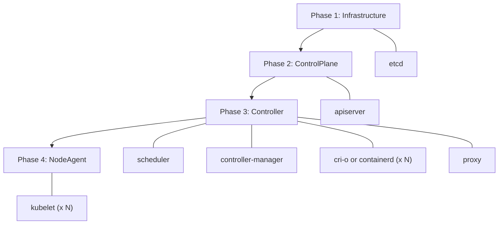

<picture>
  <source media="(prefers-color-scheme: dark)" srcset=".github/logo-dark.png">
  
</picture>

[](https://github.com/saschagrunert/kubernix/actions/workflows/ci.yml)
[](https://codecov.io/gh/saschagrunert/kubernix)
[](https://saschagrunert.github.io/kubernix/kubernix/index.html)
[](https://docs.rs/kubernix)
[](https://deps.rs/repo/github/saschagrunert/kubernix)
[](https://crates.io/crates/kubernix)
[](https://github.com/saschagrunert/kubernix/blob/main/LICENSE)

## Kubernetes development cluster bootstrapping with Nix packages

This project aims to provide **single dependency** [Kubernetes][1] clusters
for local testing, experimenting and development purposes.

[1]: https://kubernetes.io

Moving pictures are worth more than thousand words, so here is a short demo:


### Nix?

Have you ever heard about [Nix][2], the functional package manager?

In case you haven’t, don’t worry, the important thing is that it provides all the third-party
dependencies needed for this project, pinned to a dedicated version. This guarantees stable,
reproducible installations.

[2]: https://nixos.org

KuberNix itself is a Rusty helper program, which takes care of bootstrapping
the Kubernetes cluster, passing the right configuration parameters around and
keeping track of the running processes.

### What is inside

The following technology stack is currently being used:

| Application     | Version  |
| --------------- | -------- |
| cfssl           | v1.6.5   |
| cni-plugins     | v1.9.1   |
| conmon          | v2.2.1   |
| conntrack-tools | v1.4.9   |
| containerd      | v2.4.1   |
| cri-o-wrapper   | v1.37.2  |
| cri-tools       | v1.37.0  |
| crun            | v1.30.1  |
| etcd            | v3.7.2   |
| iproute2        | v7.2.0   |
| iptables        | v1.8.13  |
| kmod            | v31      |
| kubectl         | v1.37.1  |
| kubernetes      | v1.37.1  |
| nss-cacert      | v3.131.1 |
| podman          | v5.8.9   |
| rootlesskit     | v2.3.6   |
| runc            | v1.5.2   |
| slirp4netns     | v1.3.6   |
| socat           | v1.8.1.3 |
| sysctl          | v4.0.7   |
| util-linux      | v2.42.4  |

Some other tools are not explicitly mentioned here, because they are not
direct dependencies.

### Boot Phases

Components start in four sequential phases. Within each phase, components
start in parallel. If any component in a phase fails, subsequent phases
are skipped. Once all components are running, KuberNix deploys the cluster
addons (CoreDNS by default) in the background.



### Requirements

As already mentioned, there is only one real dependency needed to run this
project: **Nix** (with [flakes][3] enabled). To set up Nix, run:

```shell
$ curl -L https://nixos.org/nix/install | sh
```

Please make sure to follow the instructions output by the script and that
[flakes are enabled][3] in your Nix configuration.

[3]: https://wiki.nixos.org/wiki/Flakes

Besides that, KuberNix expects a Linux host (`x86_64` or `aarch64`). All
cluster components and tools come from Nix.

KuberNix runs in **root mode** when started as root, for example via `sudo`:

- `nix` has to be in the `PATH` of root, for example via
  `sudo env "PATH=$PATH" kubernix`.
- The kernel modules `overlay`, `br_netfilter` and `ip_conntrack` get loaded
  and the required sysctls get set automatically. Inside a container this
  step is skipped, so run [`contrib/prepare-system`](contrib/prepare-system)
  on the host instead.

Otherwise, it runs in **rootless mode**, which requires:

- Unprivileged user namespaces (`kernel.unprivileged_userns_clone=1`). On
  Ubuntu 23.10+, `kernel.apparmor_restrict_unprivileged_userns=0` may be
  needed as well.
- cgroup v2 with the `memory`, `cpu`, `pids` and `io` controllers delegated
  to the user.
- The setuid helpers `newuidmap` and `newgidmap` on the host (for example
  from the `uidmap` or `shadow` package) and entries for the user in
  `/etc/subuid` and `/etc/subgid`. Nix cannot provide setuid binaries.
- `systemd-run` with a systemd user session, since KuberNix runs itself via
  `systemd-run --user --scope`.

### Getting Started

#### Cluster Bootstrap

To bootstrap your first cluster, download the static binary for your
architecture (`kubernix-x86_64` or `kubernix-aarch64`) from the
[latest release][4] or build the application via:

[4]: https://github.com/saschagrunert/kubernix/releases/latest

```shell
$ make build-release
```

The binary is now available at `target/release/kubernix`. Alternatively,
install the application via `cargo install kubernix`. Downloaded release
binaries can be checked as described in
[Verifying Releases](#verifying-releases).

Then start KuberNix:

```
$ kubernix
```

KuberNix now sets up the Nix environment, downloads the needed binaries and
starts the cluster. By default, it creates a directory called `kubernix-run` in
the current path, which contains all data of the cluster.

When running as a non-root user, KuberNix uses `rootlesskit` to provide a user
namespace where all components run as fake root (see the
[requirements](#requirements)). The cluster runs in its own network
namespace, which `slirp4netns` connects to the outside world. Only the
API server port (6443) is published to `127.0.0.1` on the host, so NodePort
Services and host ports are not reachable from the host, and the cluster
cannot reach services listening on the loopback interface of the host. The
`--cidr` must not overlap with the slirp4netns network `10.0.2.0/24`. Kernel
modules cannot be loaded explicitly from the user namespace. The kernel loads
the netfilter modules for the pod network and kube-proxy on demand, otherwise
they have to be loaded on the host (for example `iptable_nat` and
`nf_conntrack`).

In multi-node rootless mode, all nodes run as direct processes (no container
isolation) with `--hostname-override` for node identity. Every kubelet runs in
its own mount namespace, because it always uses
`/var/lib/kubelet/device-plugins`, and writes its pod logs into its node
directory. Running with `sudo` gives container-based multi-node isolation.

#### Shell Environment

If everything went fine, you should be dropped into a new shell session,
like this:

```
[INFO ] Everything is up and running
[INFO ] Spawning interactive shell
[INFO ] Please be aware that the cluster stops if you exit the shell
>
```

Now you can access your cluster via tools like `kubectl`:

```
> kubectl get pods --all-namespaces
NAMESPACE     NAME                       READY   STATUS    RESTARTS   AGE
kube-system   coredns-85d84dd694-xz997   1/1     Running   0          102s
```

All configuration files have been written to the target directory, which is now
the current one:

```
> ls -1p
apiserver/
controllermanager/
coredns/
crio/          # or containerd/ when using --cri-runtime=containerd
encryptionconfig/
etcd/
kubeconfig/
kubelet/
kubernix.env
kubernix.lock
kubernix.pid
kubernix.toml
nix/
pki/
policy.json
proxy/
scheduler/
```

For example, the log files for the different running components are now
available within their corresponding directory:

```
> ls -1 */*.log */*/*.log
apiserver/kube-apiserver.log
controllermanager/kube-controller-manager.log
crio/<node>/crio.log  # or containerd/<node>/containerd.log
etcd/etcd.log
kubelet/<node>/kubelet.log
proxy/kube-proxy.log
scheduler/kube-scheduler.log
```

The CRI runtime and kubelet data is stored per node, where `<node>` is the
hostname for a single node cluster and `node-0`, `node-1`, … in multinode mode.
If a component runs inside a node container (multinode root mode), then its
log file is named after the container runtime, for example
`crio/node-1/podman.log`.

The kubeconfigs embed the client keys, so they are only readable by their
owner. When running via `sudo`, the `kubeconfig/admin.kubeconfig` belongs to
the invoking user.

If you want to spawn an additional shell session, simply run `kubernix shell`
in the same directory as where the initial bootstrap happened. In rootless
mode, the shell enters the namespaces of the running cluster via `nsenter`.
If no cluster is running there (or it is not ready yet), `kubernix shell`
fails with an error. Only one KuberNix instance can run per run directory, a second one fails to
start and points to `kubernix shell` instead.

```
$ kubernix shell
[INFO ] Spawning new kubernix shell in: '/…/kubernix-run'
> kubectl run alpine --image=alpine -it --rm -- sh
If you don't see a command prompt, try pressing enter.
/ #
```

This means that you can spawn as many shells as you want to.

#### Cleanup

The whole cluster gets automatically destroyed if you exit the shell session
from the initial process:

```
> exit
[INFO ] Cleaning up
```

The same happens on `SIGTERM` or `SIGHUP`, as well as on `SIGINT` (Ctrl+C)
during the bootstrap or with `--no-shell`. KuberNix writes its PID to
`kubernix.pid` in the run directory once the cluster is ready and removes it
after the cleanup. With `--no-shell`, it also shuts the cluster down if one of
its components dies.

Please note that the directory where all the data is stored is not being
removed after the exit of KuberNix. This means that you’re still able to
access the log and configuration files for further processing. If you start
the cluster again, then the cluster files will be reused. This is especially
handy if you want to test configuration changes.

#### Restart

If you start KuberNix again in the same run directory, then it will re-use the
configuration during the cluster bootstrapping process. This means that you
can modify all data inside the run root for testing and debugging purposes.
Run directories created by an incompatible KuberNix version are rejected and
have to be removed (see [Run Directory](#run-directory)). The startup of the
individual components will be initiated by JSON files called `run.json`, which
are available inside the directories of the corresponding components. For
example, etcd gets started via:

```
> cat kubernix-run/etcd/run.json
```

```json
{
  "command": "/nix/store/…-etcd-…/bin/etcd",
  "args": [
    "--auto-compaction-mode=periodic",
    "--auto-compaction-retention=1h",
    "--client-cert-auth",
    "…",
    "--advertise-client-urls=https://127.0.0.1:2379",
    "--cert-file=/…/kubernix-run/pki/etcd.pem",
    "--data-dir=/…/kubernix-run/etcd/run",
    "…"
  ]
}
```

The generated Nix environment in the `nix` directory is an exception: it gets
regenerated if it differs from the one of the running KuberNix version, for
example after an upgrade or when the content of the overlay changed. The
evaluated environment is cached as a Nix profile in `nix-profile/<hash>`, where
the hash covers the files of the `nix` directory. This includes all inputs,
since the overlay gets copied into it and cannot refer to other local files
(see [Overlays](#overlays)). Starting KuberNix or a new shell re-enters the
cached environment without evaluating the flake again, and a changed or
unusable environment, for example one with removed store paths, gets replaced.
The profile is a garbage collector root as well, so `nix-collect-garbage` keeps
the store paths of the run directory until it gets removed. The CRI runtime
configurations are always rendered, since they reference the Nix store paths.

The `kubernix.toml` keeps the settings of the existing cluster. Options which
shape the cluster (`--nodes`, `--cidr`, `--cri-runtime`, `--oci-runtime`,
`--container-runtime` and the rootless mode) cannot be changed for an existing
run directory, so remove it to apply different values. Other options like
`--log-level`, `--shell` or `--packages` override the stored values if they are
set on the command line or via the environment.

### Verifying Releases

Every release ships the `kubernix-x86_64` and `kubernix-aarch64` binaries, an
SPDX 2.3 SBOM per binary (`kubernix-<arch>.spdx.json`) and a `SHA256SUMS` file
covering all of them.
`SHA256SUMS` is signed keyless with [cosign](https://docs.sigstore.dev/cosign/)
and the signature is published as `SHA256SUMS.sigstore.json`. To verify a
downloaded binary with cosign v3 (cosign v2 needs `--new-bundle-format` in
addition):

```shell
$ cosign verify-blob SHA256SUMS \
    --bundle SHA256SUMS.sigstore.json \
    --certificate-identity-regexp '^https://github\.com/saschagrunert/kubernix/\.github/workflows/ci\.yml@refs/tags/v' \
    --certificate-oidc-issuer https://token.actions.githubusercontent.com
$ sha256sum -c SHA256SUMS --ignore-missing
```

The binaries also carry GitHub build provenance and SBOM attestations:

```shell
$ gh attestation verify kubernix-x86_64 --repo saschagrunert/kubernix
$ gh attestation verify kubernix-x86_64 --repo saschagrunert/kubernix \
    --predicate-type https://spdx.dev/Document/v2.3
```

Whether known vulnerabilities in dependencies affect KuberNix is tracked in
the [OpenVEX](https://openvex.dev) document
[`.openvex/kubernix.openvex.json`](.openvex/kubernix.openvex.json). It is a
living document, not a release asset, so scanners should fetch the current
version from
`https://raw.githubusercontent.com/saschagrunert/kubernix/main/.openvex/kubernix.openvex.json`:

```shell
$ grype sbom:kubernix-x86_64.spdx.json --vex kubernix.openvex.json
$ trivy sbom --vex kubernix.openvex.json kubernix-x86_64.spdx.json
```

Each statement uses the versioned package URL of the affected dependency as
product, so it applies as long as that dependency version ships and ages out
when it gets bumped. The advisory needs all of its IDs as name and aliases,
since grype matches the GHSA and trivy the CVE ID. This form was verified with
grype v0.120.0 and trivy v0.76.1 scanning the release SBOM as above, both
ignore a `pkg:cargo/kubernix` product with the dependency as subcomponent.
Statements get added with [`vexctl`](https://github.com/openvex/vexctl) and
checked with `make lint-vex`, for example:

```shell
$ vexctl add --in-place .openvex/kubernix.openvex.json \
    --product pkg:cargo/crossbeam-channel@0.5.12 \
    --vuln RUSTSEC-2025-0024 \
    --aliases CVE-2025-4574,GHSA-pg9f-39pc-qf8g \
    --status not_affected \
    --justification vulnerable_code_not_in_execute_path
```

### Configuration

KuberNix can be configured via command line arguments or environment
variables:

| CLI argument          | Description                                                                 | Default        | Environment Variable         |
| --------------------- | --------------------------------------------------------------------------- | -------------- | ---------------------------- |
| `-r, --root`          | Path where all the runtime data is stored                                   | `kubernix-run` | `KUBERNIX_ROOT`              |
| `-l, --log-level`     | Logging verbosity (`off`, `error`, `warn`, `info`, `debug` or `trace`)      | `info`         | `KUBERNIX_LOG_LEVEL`         |
| `--log-format`        | Log output format (`text` or `json`)                                        | `text`         | `KUBERNIX_LOG_FORMAT`        |
| `-c, --cidr`          | CIDR used for the cluster network                                           | `10.10.0.0/16` | `KUBERNIX_CIDR`              |
| `-s, --shell`         | The shell executable to be used                                             | `$SHELL`/`sh`  | `KUBERNIX_SHELL`             |
| `--no-shell`          | Do not spawn an interactive shell after bootstrap                           | `false`        | `KUBERNIX_NO_SHELL`          |
| `-n, --nodes`         | The number of nodes to be registered (`1` to `64`)                          | `1`            | `KUBERNIX_NODES`             |
| `--container-runtime` | Container runtime for the node containers, only used in multinode root mode | `podman`       | `KUBERNIX_CONTAINER_RUNTIME` |
| `-o, --overlay`       | Nix package overlay to be used                                              |                | `KUBERNIX_OVERLAY`           |
| `-d, --dockerfile`    | Custom Dockerfile for the multi-node container image                        |                | `KUBERNIX_DOCKERFILE`        |
| `-p, --packages`      | Additional Nix packages to be added to the environment, comma separated     |                | `KUBERNIX_PACKAGES`          |
| `--cri-runtime`       | CRI runtime to use (`crio` or `containerd`)                                 | `crio`         | `KUBERNIX_CRI_RUNTIME`       |
| `--oci-runtime`       | Default OCI runtime (`crun` or `runc`)                                      | `crun`         | `KUBERNIX_OCI_RUNTIME`       |
| `-a, --addons`        | Cluster addons to deploy, comma separated (`coredns`), `none` disables all  | `coredns`      | `KUBERNIX_ADDONS`            |

Options which take a list accept comma separated values and can be repeated,
for example `--packages=kubernetes-helm,jq` or `-p kubernetes-helm -p jq`. The
same applies to their environment variables, like
`KUBERNIX_PACKAGES=kubernetes-helm,jq`. Boolean environment variables like
`KUBERNIX_NO_SHELL` take `true` or `false`. The `--root` option can also be
given after the `shell` subcommand.

Please ensure that the CIDR is not overlapping with existing local networks and
that your setup has access to the internet. The CIDR will be automatically split
up over the necessary cluster components: the first half is the cluster network,
which gets split equally into the pod networks of the nodes, and the second half
contains the service network, which is at most a `/16`. For example, the default
`10.10.0.0/16` results in the pod network `10.10.0.0/17` and the service network
`10.10.128.0/17` for a single node, while three nodes get the pod networks
`10.10.0.0/19`, `10.10.32.0/19` and `10.10.64.0/19`.

#### OCI Runtimes

Both [crun][5] and [runc][6] are registered as runtime handlers named `crun`
and `runc` for CRI-O as well as containerd, each with its own state directory
(`<cri>/<node>/crun` and `<cri>/<node>/runc`). The `--oci-runtime` option
selects the handler used for pods without a runtime class, while pods can
select the other one via a [RuntimeClass][7]:

```yaml
apiVersion: node.k8s.io/v1
kind: RuntimeClass
metadata:
  name: runc
handler: runc
```

If the other runtime cannot be found, then KuberNix warns and does not register
its handler, while a missing default runtime is an error. This works in single
node, multinode and rootless mode. The container runtime used for the node
containers in multinode mode (`--container-runtime`) is not affected by this
option.

[5]: https://github.com/containers/crun
[6]: https://github.com/opencontainers/runc
[7]: https://kubernetes.io/docs/concepts/containers/runtime-class

#### Multinode Support

It is possible to spawn multiple worker nodes, too. To do this, simply adjust
the `-n, --nodes` command line argument. Every node gets its own CRI runtime
and kubelet. In rootless mode, they run as processes in the same user and
network namespace. In root mode, they run inside containers, which mount the
Nix store of the host read-only and use the `PATH` of the Nix environment, so
the nodes run the same binaries as the host without building or pulling an
image which contains them. The image of the containers only consists of a
minimal root file system (the `/etc/passwd` and `/etc/group` of root as well
as `/run`, `/tmp` and `/var/tmp`), which KuberNix imports on the first
multinode run. The container runtime can be selected via
`--container-runtime`. The default runtime is [podman][8], but other Docker
compatible runtimes should work as well.

The nodes trust the same CA bundle for pulling images as the components on the
host: the one of `SSL_CERT_FILE`, otherwise the first system bundle like
`/etc/ssl/certs/ca-certificates.crt` or `/etc/pki/tls/certs/ca-bundle.crt`,
otherwise the one of the Nix environment. A bundle outside of the Nix store
gets mounted read-only to `/etc/ssl/certs/ca-certificates.crt`, so registry CAs
installed on the host work in multinode mode as well.

A custom image can be built via `-d, --dockerfile`, for example to provide
additional files in the node containers. Its build context is the directory of
the Dockerfile. The Nix store and the environment get mounted into the
containers the same way, so the image does not need to contain Nix. Note that
the mounted store hides a `/nix/store` of the image. The node images are tagged
with a hash of their inputs (`kubernix:base-<hash>`): the content of the
default image, or the custom Dockerfile together with the metadata (path,
mode, size and modification time) of all files in its build context, except
the run directory. So they get recreated if the inputs change, which is why
the build context should be small, and the images of previous builds get
removed afterwards.

All nodes share the network namespace of the host (or the one of rootlesskit),
where every node has its own bridge. The bridges masquerade the traffic leaving
the cluster network, while an iptables rule exempts the traffic between pods of
different nodes, so it is routed without NAT.

[8]: https://github.com/containers/podman

#### Overlays

Overlays provide a method to extend and change Nix derivations. This means
that we’re able to change dependencies during the cluster bootstrapping
process. For example, we can build CRI-O from a fork by writing this
`overlay.nix`:

```nix
self: super: {
  cri-o-unwrapped = super.cri-o-unwrapped.overrideAttrs (old: {
    src = super.fetchFromGitHub {
      owner = "my-user";
      repo = "cri-o";
      rev = "0123456789abcdef0123456789abcdef01234567";
      hash = "sha256-…";
    };
  });
}
```

The `cri-o` package only wraps `cri-o-unwrapped`, which contains the actual
build. The overlay replaces the default one in the generated Nix environment,
which is a flake evaluated in pure mode. This means that it cannot refer to
local paths outside of it, so sources have to be fetched with a fixed hash.

Now we can run KuberNix with the `--overlay, -o` command line argument:

```
$ kubernix --overlay overlay.nix
[INFO ] Using custom overlay 'overlay.nix'
these 2 derivations will be built:
  /nix/store/…-cri-o-….drv
  /nix/store/…-cri-o-wrapper-….drv
building '/nix/store/…-cri-o-….drv'...
```

This makes it easy to try out patched or new versions of the cluster
components.

#### Additional Packages

It is also possible to add additional packages to the KuberNix environment by
specifying their nixpkgs attribute names via the `--packages, -p` command line
parameter. This way you can use additional tools in a reproducible way. For
example, to always use the same [Helm][9] version, run:

```
$ kubernix -p kubernetes-helm
[INFO ] Bootstrapping cluster
…
> helm version
version.BuildInfo{Version:"v…", …}
```

Multiple packages can be passed comma separated, for example
`-p kubernetes-helm,jq` or `KUBERNIX_PACKAGES=kubernetes-helm,jq`. All
available packages are listed on the [official Nix package search][10].

[9]: https://helm.sh
[10]: https://search.nixos.org/packages?channel=unstable

### Stability

Starting with version 1.0, KuberNix follows [semantic versioning][11] for the
interfaces listed below. Breaking changes to them require a new major version,
while minor versions may add new options, subcommands, environment variables,
log fields or files.

[11]: https://semver.org

#### Command Line

- The subcommands, the long option names and the short options in the
  [configuration table](#configuration), as well as their value formats.
- The environment variables of the options (`KUBERNIX_*`), which take the same
  values as the options.
- The `-e`, `-f` and `-u` short options of earlier versions keep working as
  hidden aliases of `--no-shell`, `--log-format` and `--container-runtime`, but
  are no longer documented. The same applies to `--addons` without a value,
  which equals `--addons none`, and to multiple space separated values after
  `--packages`.

The versions of the bundled packages (see [What is inside](#what-is-inside))
are not part of the stable interface and get updated in any release.

#### Exit Codes

| Code | Meaning                                                                                              |
| ---- | ---------------------------------------------------------------------------------------------------- |
| `0`  | Success, for example after the interactive shell exited or on `SIGTERM` with `--no-shell`            |
| `1`  | Any error, including a failed bootstrap, a dying component with `--no-shell` or an aborted bootstrap |
| `2`  | Command line arguments or environment variables which cannot be parsed                               |

`kubernix shell` replaces itself with the spawned shell, so it returns the exit
code of the shell once the shell started. Subcommands may define further exit
codes, which are documented together with them.

#### Environment File

The `kubernix.env` file in the run directory can be sourced by any POSIX shell.
Every line has the format `export KEY='value'`, where the value uses POSIX
single quoting. It contains at least these variables:

- `KUBECONFIG`: the path to the admin kubeconfig.
- `CONTAINER_RUNTIME_ENDPOINT`: the CRI socket of the first node, as
  `unix://<path>`.

#### JSON Logs

With `--log-format=json`, KuberNix writes one JSON object per line to stderr
with the following fields:

- `level`: one of `error`, `warn`, `info`, `debug` or `trace`.
- `message`: the log message, which is meant for humans and may change.
- `target`: the source of the message, which is meant for debugging and may
  change.

Consumers should ignore unknown fields. The error which terminates KuberNix and
its causes are always written as plain text lines (`[ERROR] …`), since they may
occur before the logger is set up. Command line arguments and environment variables
which cannot be parsed (exit code `2`) are reported in the format of the argument
parser instead.

#### Run Directory

The run directory (`--root`) keeps these files at stable locations:

- `kubernix.toml`: the configuration of the cluster, see below.
- `kubernix.env`: the environment file described above.
- `kubeconfig/admin.kubeconfig`: the kubeconfig of the cluster admin.
- `kubernix.pid`: the PID of the running KuberNix instance, written once the
  cluster is ready and removed after the cleanup.
- The component log files listed in [Shell Environment](#shell-environment).

All other files, like the PKI, the component configurations and the generated
Nix environment, are internal and may change in any release.

The `kubernix.toml` contains a `version` field, which is the format version of
the run directory. A run directory without it has version 0. KuberNix uses run
directories of the same version as is, migrates those of older versions in
place if possible, and otherwise refuses them with an error asking to remove
the run directory. It also refuses run directories created by a newer
KuberNix, starting with 1.0: earlier versions ignore the `version` field and
use any run directory. Version 2 changed the network layout and the PKI, so run
directories of version 0 and 1 have to be removed, and KuberNix versions before
1.0 must not be used with run directories of version 2. The other fields of
the file are not part of the stable interface.

#### Library

The `kubernix` crate only exists to build the command line tool. Its library
target is not a public API, is hidden from the documentation and is not covered
by semantic versioning.

## Contributing

You want to contribute to this project? Wow, thanks! So please just fork it and
send me a pull request. The `build` dev shell of the flake provides all tools
needed for development, for example via `nix develop .#build`.
