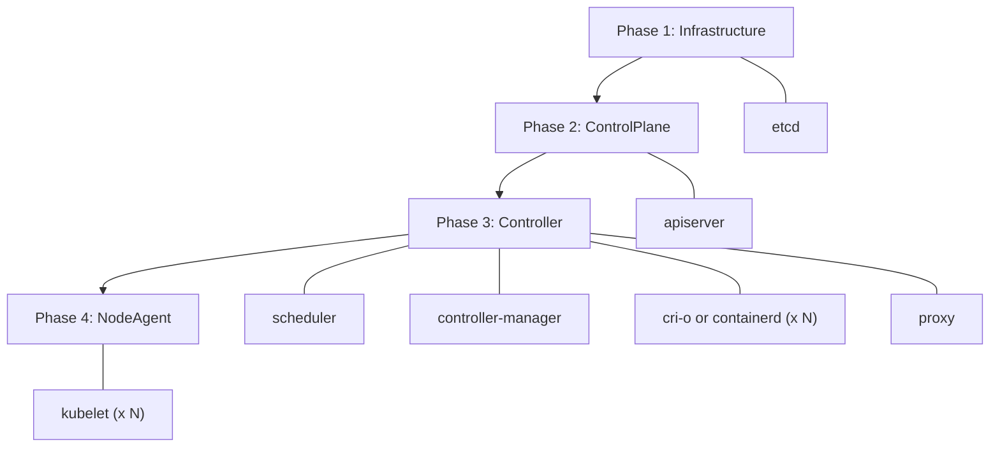

# Architecture

## Boot Phases

Components start in four sequential phases. Within each phase, components start
in parallel. If any component in a phase fails, subsequent phases are skipped.
Once all components are running, KuberNix deploys the cluster addons (CoreDNS by
default) in the background.

